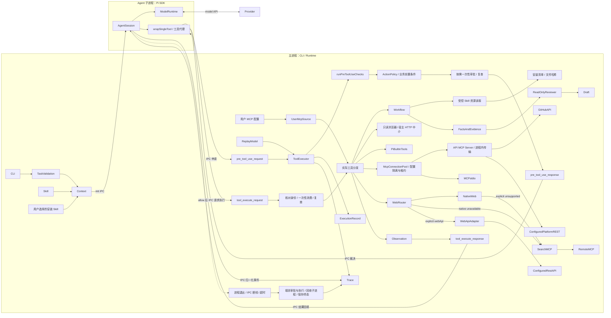

# 架构与实现边界

默认架构为通用 Agent + Skill：Task → 分层 Context → Pi AgentSession 模型决策 → 工具执行回调 → ToolExecutor → Observation → SDK 续轮/最终回答。AgentSession 在独立子进程管理历史和循环，工具意图与结果经 Node IPC 往返；主进程负责权限、实际执行、预算、持久化和故障收尾。共享循环位于 task-runtime.ts，普通任务由 agent.ts 保存回答，原调查业务由可选 investigation.ts / investigation-workflow.ts 提供。Web 工作台与 CLI 均可选择普通任务或调查模板。具体调用图及 Skill 边界见 [通用 Agent](generic-agent.md)。

## 数据流

来源现在仅以 builtin/mcp 注册；workflow 是内部业务工具。平台 API 配置按 Craft 的 API Tool → MCP Server 方式装配，经池内 MCP Client 的 tools/list、tools/call 调用，通用平台 API 不保留直接 api 执行通道；专用 Web API 使用下述本地工具路径。通用来源 MCP 使用 stdio；web 路由使用通用远程 MCP 配置（SEARCH_MCP_URL/SEARCH_MCP_TOKEN），支持 Streamable HTTP 和旧版 SSE，通过官方 SDK Client 连接、发现和调用，自动匹配常见搜索/抓取参数与结果格式。无厂商枚举或固定地址，模型密钥与搜索密钥独立；Trace 使用 mcp.remote 后端身份，记录 serverId、实际工具、输入及 Schema 哈希。未配置专用 webApi 时优先级为受控原生工具 → 配置的搜索 MCP，每个阶段重新检查父工具绑定和有效权限。自建联网保底已移除，MCP 失败后直接保留错误；旧的 official_web 工具已删除，官网读取统一使用 web_fetch；结构化解析函数仍供浏览器采集使用。非标准必填参数和不明结果明确拒绝；不声称能自动理解任意远程工具语义。只读浏览器使用 builtin，GitHub 和通用 REST API 均包装成 MCP；CLI 采集适配器已移除。宿主 MCP 池按运行复用来源与用户 MCP 连接；Agent 仍通过统一 Node IPC 代理访问。外部 HTTP 池端点及 Craft 其他后端未实现。Pi AgentSession 是真实调查的会话后端，内部复用既有 ModelRuntime 选择模型与认证。SDK 调度注册的业务工具，execute 回调统一进入 ToolExecutor；禁止未经包装的默认编码工具自动注册、隐式扩展、自动重试与自动压缩；SDK 七个内建工具通过宿主 PiBuiltinSource 显式接入，见 pi-builtins.md。首次与每次续轮前检查预算；参数或未知工具被 SDK 拒绝时也保存失败 Observation。ReplayModel 使用确定性单步驱动，共享相同业务回调。独立 probe:model 保留 completeSimple 联通请求。详见 sdk-adapter-map。

Search / Fetch 是固定名称与 Schema 的宿主自建工具。`webApi: { search, fetch }` 使用本地 WebApiAdapter 直接执行 REST API，无进程内 MCP 连接、发现与调用；旧 searchMcp.type=api 是兼容配置，同样执行本地路径。显式 API 配置优先，独立于模型密钥；API 与 searchMcp 配置互斥。API 请求经 web.api.web_search/web_fetch 和 web.api.http.search/fetch 两层权限 stage；Trace 标记 backend=web.api、protocol=http、transport=direct。外部 MCP 与这些本地工具共同进入 ToolRegistry / PreToolUse / ToolExecutor，统一的是调用与治理机制。通用平台 API / GitHub 的 MCP 包装保持现有实现。配置与 Search / Fetch 具体实现见 web-api.md。

ContextPipeline.prepareTurn 固定每轮的 Skill 正文校验、模式分支、实体/来源/时间窗装配、工具面筛选与字符检查。Skill 安装/选择时解析 YAML，运行中使用冻结正文。Pi 续轮实际刷新 system prompt；初始未披露或后来替换的绑定不在本次会话自动扩权。context_prepared 记录上下文/Skill 哈希、模式及完整工具面，model_usage 按轮记录提供方用量。

新 Trace 带 schemaVersion=2，先用 AgentEventSchema 验证载荷再落盘；旧版日志保持读取，混合降级版本被拒绝。浏览器/API MCP 配置、HTTP 中介、独立验收入口和当前限制见 source-adapters.md、platform-api-mcp.md。

## 执行门禁

ToolBinding 是披露、Schema 校验、权限和调用的唯一映射；按原名派发。Proxy 净化碰撞原子拒绝；修订变化撤销旧 ID。SourceClient 与 registry.dispatcher 属于宿主内部适配层，不作为模型、网络或 CLI 执行入口。调查入口是 run，状态命令是 inspect/recover/replay，配置管理是 mcp/skills；工具执行入口只有 ToolExecutor；无直接池 HTTP 旁路。这里不对可导入宿主模块的恶意本地代码提供隔离承诺。

策略按宿主声明的 action 和参数范围判定，而非 HTTP method 或工具名字。explore/ask/allow-all 三种模式中 collect/analyze/local_draft 在任务范围内均允许；modify/send/publish 在 explore 拒绝、ask 逐次审批、allow-all 直接放行。模式不跳过工具绑定、Schema、任务来源、参数范围或激活状态检查。旧 safe 输入归一为 explore，历史日志兼容；详见 permissions.md。Schema 和 scope 在审批前、实际调用前都核对。审批绑定 taskId/requestId/tool/hash/expiry，pending 一次性消费，不暴露 approve-all。模型或子进程不掌握宿主 mode setter。

## 上下文与流程

stable = 宿主规则 + 实际读取的默认 Skill 与所选用户 Skill；调查模板额外装配实体和时间约束。volatile = 任务约束 + 来源状态 + 已脱敏 observations。工具 Schema 计入字符预算。预算超限拒绝而不静默裁剪关键字段。未测缓存收益、不转换为虚构 token 指标。

调查模板的流程守卫：save_plan 写入 → 读回 Schema + 内容一致 → callback → submitted。文件失败与 callback 失败分事件。未 submitted 不能采集；分析后不能追加采集，需新运行；review 只能在 analyze 后，draft 只能在 review 后，主张集合必须精确对应分析结果，最终 respond 只能在 draft 后。普通任务没有这些业务阶段，不注册 workflow 工具；Skill 指导步骤，宿主保留权限、来源范围与预算检查。计划回调不提供自动恢复调度。

## 状态、Trace 与恢复

上述禁用自动压缩指 SDK 内置行为。宿主适配层现由 PiContextManager 显式管理压缩：完整原生转录经主进程脱敏追加到 sessions/<runId>.jsonl；模型请求使用初始任务、最新摘要、保留完整工具轮次与边界后的新消息。压力同时考虑字符、模型窗口、usage 的输入/输出/缓存以及新增消息，预留输出空间。摘要请求同样计入 Token 与超时预算，业务 observations 和 Trace 不因压缩删除。详见 session-context.md。

执行：awaiting_permission → executing → completed/failed/cancelled/unknown；拒绝从 awaiting_permission 直接到 failed，execute_count=0。调用中取消，collect 等只读标 cancelled；外发/发布可能发生的结果不可确认时 unknown。工具返回 HTTP401 仍可代表一次 completed 的调用，领域 RetrievalResult 单独标 auth_failed，不能混为业务采集成功。

Run：running → complete/partial/failed/cancelled；重启未决 snapshot → unknown，不发工具。partial 表示有草稿但存在采集缺口、未知时点或审阅不接受。Trace append-only 有序日志是 AgentState 重建依据，snapshot 仅缓存。每个执行含 requestId、taskId、runId、sourceSlug、完整绑定、参数 hash、起止时点、错误和执行数。TraceSchema 验证 envelope、事件枚举、权限先于执行、审批、终态顺序和脱敏；usage_reported 保存提供方返回的实际用量，replay 无模型用量。

调用方 signal + Runtime 有引用定时器贯穿模型、审批、执行器、MCP 和 fetch；abortable 阻止不合作适配器的迟到响应改写状态。无法强制杀死第三方远端副作用。CLI 文件锁限制同目录单写者，未实现多文件事务/WAL；重启只查询和标未知，不声称会话无损恢复。

## 事实与证据

entity ID/domain + product 区分稳定对象；名称只是显示。canonical eventKey 由站点/API 映射给出，不按标题合并。版本 ID 由 event/value/polarity 构成，历史证据不覆盖。每次采集快照含 raw、URL、sourceSlug、published_at/retrieved_at 和 provenance。未知发布时间保留 null，时间窗左闭右开，时间依据不混用。

Reviewer 是纯只读函数；Runtime 在保存意见前再核对快照存在/哈希。自由模型叙述不属于规则 Reviewer 的已接受事实。当前规则样例证明固定归因、去重、时间、冲突行为，不是通用事实准确率。JSON-LD/Node 发布解析器及 GitHub 发布 Adapter 为明确支持范围，不承诺任意网站通用语义理解。

参考源码与本工程对应：Craft SourceServerBuilder → 本工程来源 builder；McpClientPool 映射 → ToolRegistry；wrapToolsWithHooks/wrapSingleTool → Pi 工具包装；runPreToolUseChecks/pre_tool_use_response → 统一检查与类型化宿主裁决，再由 ActionPolicy + ToolExecutor 分发；PromptBuilder → context stable/volatile；handleAbort/requestId → ApprovalManager/ExecutionRecord；submit-plan handler → save_plan 验证与 callback。全部为独立实现，不是原类的继承或 Craft Electron 运行集成。
