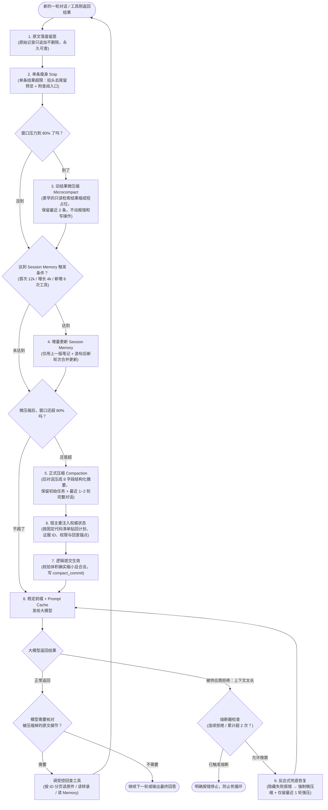

# 上下文治理机制总结

本文档基于 Cwatch-agent 项目的实际架构与源码整理，涵盖上下文治理核心机制、流程、易混淆概念辨析、数据来源、实战踩坑案例及核心设计问答。

---

## 一、核心思路概览（约 1 分钟）

> “我们这个项目的上下文治理，核心思路就一句话：**原始记录只存不删，只对给模型看的那一层做由轻到重的渐进式瘦身**。
>
> 具体来说，每次给大模型发请求前，后端宿主程序会按四步来治理上下文：
> 1. **先落盘再单条裁剪（Snip）**：工具返回的原始数据先完整落盘，单条结果超过上限就掐头去尾保留预览，同时给模型提供分页查原件的工具入口。
> 2. **微压缩（Microcompact）**：窗口压力到 80% 时，优先把更早的、成功的只读检索结果缩成短占位（保留最近 2 条，不动报错和写操作），零成本腾出空间。
> 3. **增量 Session Memory**：在窗口还没满的平时，按窗口增长或工具调用增量，用游标只把新增轮次和上一版笔记送进无工具的隔离请求里，维护一份独立的结构化工作状态，不用每次重扫全历史。
> 4. **正式压缩（Compaction）+ 宿主状态重注入**：微压缩后仍超 80% 才触发正式压缩，把旧对话压成固定 8 字段结构化摘要，但**不完全信任模型写的摘要**——压缩后宿主按固定代码规则，从自己的工作流状态、执行账本、权限和预算配置里把真实状态重新注入上下文。
>
> 万一本地估算有偏差、被供应商报错超长，还有**反应式恢复（Reactive Compact）+ 熔断器**兜底：隐藏报错记录、强制单轮压缩再续跑，最多尝试 2 次防止死循环。同时我们把 System Prompt 和工具 Schema 规范化排序，配合 Prompt Cache 降低成本。”

---

## 二、上下文治理整体流程图

---

## 三、核心机制与分层设计

### 1. 基本原则
- **关闭 SDK 内置自动压缩与重试**：避免隐藏请求、重试或用量绕过宿主 Token/时间预算。
- **存储与视图分离**：原始记录只追加落盘，所有裁剪（Snip）、微压缩（Microcompact）和压缩边界都只修改**模型可见投影**，原始记录完整保留。
- **完整 API Round 不拆散**：压缩切点和 Session Memory 游标推进只能落在完整 API 轮次边界，不拆散 `toolCall` 和 `toolResult` 配对。
- **数据与权限隔离**：归档原文、摘要、记忆和重注入附件全部标记为 `untrusted data`，不能修改宿主权限或触发副作用重放。

### 2. 五级渐进治理漏斗
1. **Snip（单条裁剪）**：单条工具结果上限为上下文字符上限的 20%（最低 1024，最高 16000 字符），超限保留首尾预览及 `session__read_tool_result` 分页读取指引。
2. **Microcompact（微压缩）**：达到字符上限 80% 或可用输入 Token（`contextWindow - reservedOutput`）80% 时，把更早的成功只读工具结果替换为短占位，保留最近 2 条；错误、写入/外发/发布回执不参与。编辑后清除旧 `usage` 锚点。
3. **Session Memory（增量工作记忆）**：首次达到 12000 Token 初始化；此后正向窗口增长 ≥ 4000 Token 或新增工具调用 ≥ 6 次且存在完整新轮次时，在无工具隔离上下文中仅用 `旧 memory + lastMessageId 之后的新轮次` 合并更新 8 字段 JSON（`userGoal`, `completedWork`, `keyFiles`, `errorsAndFixes`, `unfinishedTasks`, `nextSteps`, `references`, `sourceGaps`）。
4. **Compaction（正式压缩）**：微压缩后仍超 80% 触发。优先保留最近 2 轮（预算不足或跨上次边界退为 1 轮）+ 固定初始任务；生成 8 字段结构化摘要，校验确实缩小且满足硬预算后，按 `compaction → attachments → hook_results → compact_commit` 逻辑提交。
5. **Reactive Compact（反应式恢复 + 熔断）**：仅针对明确的输入超长拒绝（排除 401/403/429/5xx/超时/限流），将失败回执落盘并从活动投影排除，强制仅留最近 1 轮压缩后通过 `session.agent.continue()` 续跑；连续 2 次拒绝或单次运行累计 2 次尝试即熔断。

### 3. 稳定前缀与 Prompt Cache 协同
- **职责解耦**：Prompt Cache 负责前缀复用降本，Session Memory 负责游标工作态，Compaction 负责窗口硬上限。
- **稳定前缀**：System Prompt 按“硬规则 → Skill 快照 → 实体/时间窗/白名单 → 权限模式 → 当前来源状态 → 运行预算”固定顺序组装；工具按代理名排序并规范化 Schema 键序；记录 `prefixHash` 和 `toolsetHash`。
- **缓存隔离与预算诚实**：常规业务轮次用 `cacheRetention: 'short'`，摘要与 Session Memory 用 `none`；缓存命中的 Token 仍全额计入上下文窗口压力与总预算。

---

## 四、易混淆概念辨析

| 概念 | 核心目的 | 是否改写主对话窗口 | 信息来源 |
| :--- | :--- | :--- | :--- |
| **正式压缩（Compaction）** | 窗口达到 80% 时**腾空间** | 是（旧消息替换为摘要 + 边界） | 模型生成的结构化续办摘要 |
| **宿主重注入（Post-Compact Attachments）** | 防止模型摘要写漏/写偏，把真实状态对齐回去 | 附在正式压缩摘要之后 | 后端程序自己的内存状态与本地磁盘文件 |
| **Session Memory** | 平时按进度持续记账，供模型随时查询或压缩时参考 | 否（独立文件，不改主窗口） | 模型基于游标增量合并生成的 8 字段 JSON |
| **反应式压缩（Reactive Compact）** | 接口真报“上下文太长”时的强压自救重试 | 是（排除失败回执后强制压缩） | 走正式压缩链（仅保留最近 1 轮） |

---

## 五、宿主重注入的确定性规则、数据来源与优先级

宿主不需要“思考”该注入什么，注入清单是在代码中写死的固定模板（`WorkingStateTracker.attachments` + `afterCompact`）：

1. **当前工作流状态**：读取磁盘上的 `plans/<runId>.json`（校验哈希，最多截前 4000 字），扫描 `executions/<requestId>.json` 计算各来源采集进度，导出精确 `claimIds`、`evidenceIds`、`reportPath` 与 `nextAction`。
2. **最近读取的 6 份资源片段**：仅记录宿主受控读取工具（读指南、读 Skill、读计划、读归档、读转录）成功返回的结果，每条最多 1200 字；若原磁盘文件哈希变更，则标为失效、不再注入旧片段。
3. **已加载 Skill 与资源使用**：当前生效的内置和用户 Skill 名称、版本哈希及实际读过的参考文件。
4. **当前工具与 MCP 目录**：当前权限可见且初始已披露的工具清单，按 18KB 分块，不静默丢弃。
5. **来源指南前置状态**：各允许来源的指南状态（current / unread / changed / unavailable / inactive）。
6. **未决执行与预算状态**：过滤出 `awaiting_permission / executing / unknown` 状态的调用记录、子进程状态与剩余预算。
7. **Session Memory（辅助参考）**：若 `session-memory/<runId>.json` 存在则一并附上，并显式声明 `State as of lastMessageId; newer host workflow state and messages take precedence`——**它可能滞后且由模型生成，与宿主硬账本或最新对话冲突时，以宿主硬状态和最新消息为准**。

### 运行时本地数据文件与核心源码文件

**运行时数据文件（`FileStore` 目录下）：**
- `plans/<runId>.json`：已提交的调查计划（带哈希校验）
- `executions/<requestId>.json`：每次工具调用的执行记录
- `sessions/<runId>.jsonl`：只追加的完整原始会话转录
- `session-memory/<runId>.json`：独立 Session Memory 检查点（带 `contentHash` 和版本号）
- `traces/<runId>.jsonl`：业务决策、审批、用量与审计日志

**核心源码文件：**
- 压缩与上下文准备：`packages/shared/src/agent/backend/pi/context.ts`
- 压缩逻辑提交校验：`packages/shared/src/agent/backend/pi/compact-entries.ts`
- 单条裁剪与微压缩：`packages/shared/src/agent/backend/pi/tool-result-context.ts`
- 增量 Session Memory：`packages/shared/src/agent/backend/pi/session-memory.ts`、`packages/shared/src/sessions/memory.ts`
- 反应式恢复与熔断：`packages/shared/src/agent/backend/pi/provider-rejections.ts`
- 宿主重注入组装：`packages/server-core/src/runtime/working-state.ts`、`packages/server-core/src/runtime/task-runtime.ts`
- 稳定前缀与缓存统计：`packages/shared/src/agent/core/prompt-builder.ts`、`packages/shared/src/agent/core/prompt-cache.ts`
- 设计规范文档：`docs/session-context.md`

---

## 六、实战踩坑案例（STAR）

### 案例 1：多工具并行轮次撑爆 Session Memory 维护输入
- **现象**：主上下文单条工具结果上限 16KB，Session Memory 维护输入上限 48KB。单轮并行发起 4 次 `web_search`，叠加 `assistant.thinking` 与 `toolResult.details` 后序列化超过 60KB，触发 `session_memory_delta_too_large` 导致任务中止。
- **根因**：记忆维护直接吃主上下文投影，未剥离私有思考块与冗余元数据，且对单轮本身超大缺少降级机制。
- **修复**：在记忆维护投影中剥离 `thinking` 与 `details`；当首个完整轮次仍超限时，对本轮 `toolResult` 文本做二分上限裁剪（保留首尾与原转录标记），保证工具配对完整且不超过输入预算。

### 案例 2：推理模型在 Session Memory 中把输出预算全烧在 `<thinking>`，引发级联重试
- **现象**：并行检索返回大量转义原始 JSON（48KB / 19k tokens）。推理模型（`step-5-preview`）在首轮 `maxTokens=1024` 全耗在 `<thinking>` 中（`textChars=0`）触发 `stopReason=length`；重试提高到 4096 但未缩减输入，再次耗尽输出直接报错中止；即便输入减小，首轮 1024 对推理模型仍偏紧，引发每轮双请求 + `pendingMessages` 级联消耗近 20k tokens。
- **修复**：
  1. 针对检索类 `toolResult` 在进记忆维护前做结构化紧凑投影（只保留 `status / url / title / preview / snapshot`，剔除冗余 `"raw"` 原文），48KB 压缩至 ~4KB。
  2. 对推理模型显式传递官方 `reasoning_effort=low`，首轮输出上限提升至 2048/3072，一次通过消除级联重试。
  3. 触发 `output_limit` 重试时强制收敛输入到 12KB、单条结果截到 240 字符，并禁止模型在 thinking 里逐条盘点原文。

---

## 七、常见问题解答

1. **为什么不用简单的滑动窗口截断？**
   > 滑窗会丢失初始目标、关键证据 ID 和历史报错，还容易截断 `toolCall/toolResult` 配对引发接口错误。我们通过“初始任务 + 最近完整轮次 + 结构化摘要 + 宿主硬状态重注入 + 分页原文回查”保证不断链、不丢证据。
2. **本地 Token 估算不准怎么办？**
   > 取“UTF-8 字节估算”与“最近一次供应商 `usage` 锚点 + 新增消息估算”的较大值（80% 触发压缩，编辑或压缩后立即清锚点）；真被供应商按实际 tokenizer 拒绝时，由 Reactive Compact + 熔断器兜底。
3. **怎么验证上下文治理没引入回归问题？**
   > 每个线上 badcase 都沉淀为独立回归测试（多工具并行超限、推理模型输出截断、压缩提交中断回退、投影身份校验等），并通过 Trace 中的 `purpose`（`turn/summary/memory/rejected`）、`prefixHash/toolsetHash` 和 `cacheUsage` 量化治理开销与缓存复用。
