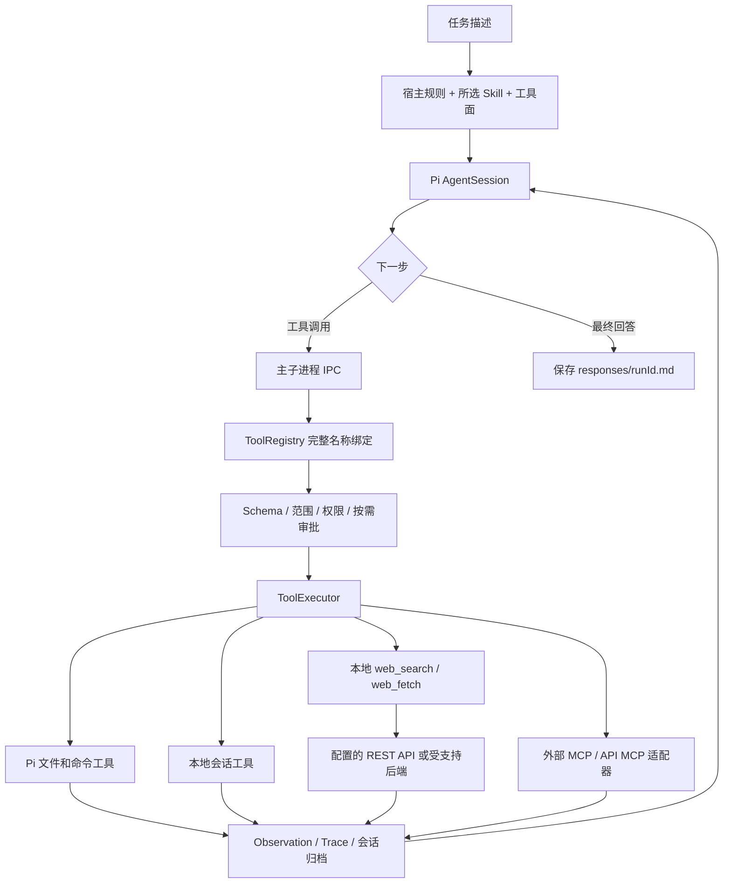

# 通用 Agent + Skill

默认入口接受自然语言任务，由 Pi AgentSession 根据任务、所选 Skill 和可见工具决定下一步。Skill 描述 SOP、材料要求和输出格式；宿主负责权限、来源范围、审批、预算、取消、会话归档和审计。

工作台真实通用 Agent 在每轮答复后等待追问，保留同一个 Pi 会话、完整转录、Memory 游标和工具结果。点击“结束会话”才正常释放进程，刷新浏览器可继续同一会话。CLI 可使用 `npm start -- run --mode live --chat --instruction "你的初始问题"`，输入 `/exit` 或结束输入即可退出。原有单次任务调用默认保持单次执行；程序可通过 `nextUserMessage(answer, signal)` 启用交互。语义、接口和重启边界见 [用户追问](conversations.md)。

## 如何使用

```powershell
npm run demo:agent
npm run web
```

工作台首页根据用户输入判断是否需要完整调研。只读本地任务和快速查询直接进入通用 Agent。配置模型后也可以通过 CLI 指定来源和已安装 Skill。

```powershell
npm start -- skills install examples/skills/research-brief
npm start -- run --mode live --instruction "阅读 README.md 和 docs/tools.md，整理项目能力、工具分类及限制，并标明文件依据" --skills research-brief --out artifacts/my-task
```

联网任务须选中配置过的来源；来源可以是本地 Web 工具、API MCP 适配器或用户 MCP：

```powershell
npm start -- run --mode live --instruction "研究 Node.js 发布记录，给出依据及未确认的问题" --source official --skills research-brief --out artifacts/research
npm start -- mcp add custom --config examples/mcp-custom.json
npm start -- run --mode live --instruction "读取 custom 服务提供的发布材料并总结，注明这是测试数据" --mcp custom --skills research-brief --out artifacts/custom-task
```

示例 custom MCP 返回 fixture 数据。真实 Web 调用需要单独配置后端。API 来源通过 `--sources` 指向现有配置文件；工作台目前提供既有来源及已安装 MCP 的选择，尚无任意 API 配置编辑器。MCP 与 Skill 的安装、启停和密钥引用见 [用户扩展](user-extensions.md)。

普通任务 JSON 使用明确的类型标记：

```json
{
  "kind": "agent",
  "taskId": "research-task",
  "instruction": "描述任务、材料及输出要求",
  "allowedSources": []
}
```

`allowedSources` 是外部来源白名单，本地文件与会话工具由宿主单独授权。`explore` 提供 read/grep/find/ls；write/edit/bash 在 `ask` 下逐次审批，在 `allow-all` 下允许执行，始终保留工作区和敏感文件检查。Skill 无法扩展白名单或授予写权限。

使用 Pi 模型的任务可选填 `responseCharacterLimit`，以非空白字符计。首次答复超限时，当前会话可在运行预算内改写一次，改写时关闭工具。如果仍超限，任务报告失败。

## 调用路线



所有工具共用注册、披露、前置检查、执行、结果回填和 Trace。只有真实 MCP 工具及 API MCP 适配器使用 `mcp__` 前缀。本地 Web、Pi、会话工具不必增加 MCP Server；以后需要让其他客户端复用某项能力时，再增加 MCP 出口。完整命名和内存映射见 [工具注册](tool-registration.md)。

`web_search` / `web_fetch` 由本地工具定义固定 Schema，配置 `webApi` 时通过 WebApiAdapter 直接调用对应 API、映射返回值并脱敏；搜索与抓取可以配置不同服务。没有自研搜索引擎，也没有为了统一调用而额外绕一层 MCP。未配置 Web API 时保留已有的受控原生或远程 MCP 后端。细节见 [本地 Search / Fetch](web-api.md)。GitHub 和通用平台 API 继续使用已有的真实 MCP 适配器。

## Runtime 与调查模板

| 模块 | 职责 |
|---|---|
| `task-runtime.ts` | 共享循环、模型钩子、权限执行器、预算、压缩附件、持久化和终态 |
| `agent.ts` | 普通任务、默认通用 Skill、工具失败缺口和最终回答保存 |
| `session-tools.ts` | 来源指南、所选 Skill 资源、当前转录、归档结果和工作记忆 |
| `investigation.ts` | 兼容原调查入口，接入业务前置条件与完成要求 |
| `investigation-workflow.ts` | 保存计划、证据分析、规则审阅和引用草稿 |
| `working-state.ts` | 按任务类型生成压缩后的续办附件 |

普通任务不注册 `workflow__*`，不要求实体、时间窗、结构化 CompetitorSignal 或 draft 成功才能回答。自定义 MCP 的普通 JSON/文本结果可以用于普通任务，不能自动被提升为已核验领域事实。

原调查模板继续保留固定的计划、分析、审阅和草稿校验，适合需要严格业务约束的任务。`npm run demo` 和原调查任务 JSON 仍使用这个入口。全项目支持的工具能力保留；五个调查工具只在对应模板中加载。

Skill 是模型遵循的步骤说明，不能保证每一步必定执行。需要强制保证的规则仍应由工具 Schema、前置条件或业务验证器检查。普通运行的 `complete` 表示模型正常结束且没有已记录工具缺口，不代表宿主已逐条验收 Skill 的自然语言要求。

验证使用真实 SDK、子进程、MCP、本地 HTTP 和浏览器，以及明确的脚本提供方；不据此声称真实模型推理准确率。

2026-10-22：完整 `npm run verify` 408/408；`npm run test:agent` 9/9；`npm run eval:web` 8/8；`npm run eval:browser` 6/6；`npm run demo:agent` 正常保存回答。日志分别位于 artifacts/generic-verify.log、generic-agent.log、generic-web.log、generic-browser.log。界面截图为 artifacts/web-eval/generic-agent.png。
